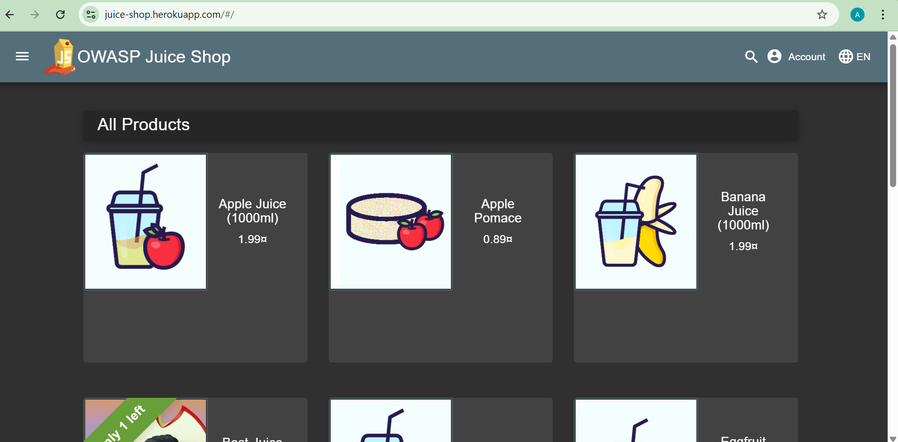
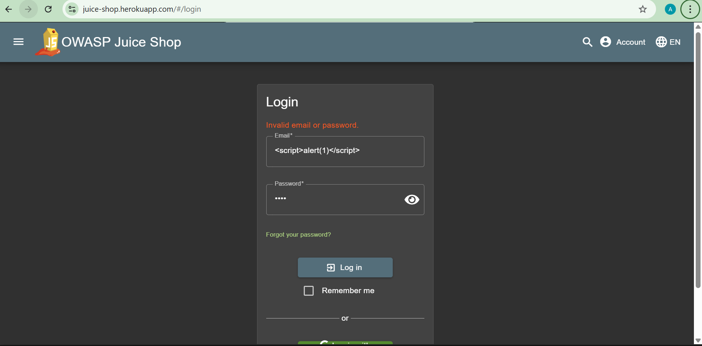
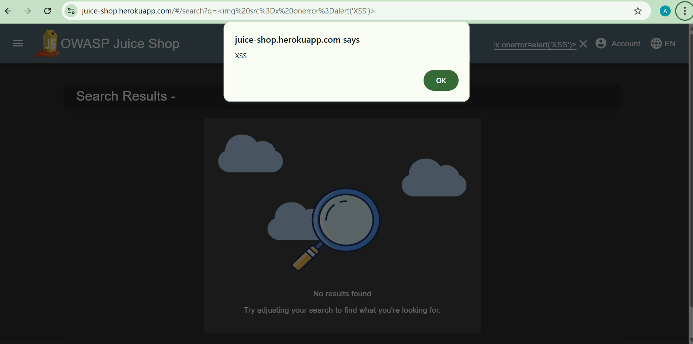
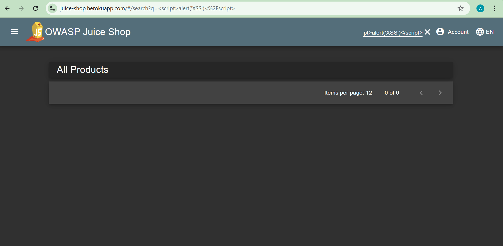

# 🔐 XSS Testing on OWASP Juice Shop


## 📌 Project Overview

This project demonstrates **Cross-Site Scripting (XSS) security testing** performed on the OWASP Juice Shop application.

The goal was to identify user input fields, test common XSS payloads, and observe how the application handles potentially malicious input. This project helped build practical knowledge of browser behavior, input handling, and XSS testing fundamentals.

## 🎯 Objectives

- Identify user input fields that may require security testing.
- Test common XSS payloads in selected fields.
- Observe whether injected scripts execute or are handled safely.
- Understand the role of input validation and context-aware output encoding.
- Document test cases, observations, and potential security concerns.

## 🛠️ Tools & Technologies

- **OWASP Juice Shop** — Intentionally vulnerable web application for security learning.
- **Google Chrome** — Browser-based testing.
- **Chrome Developer Tools** — Inspecting page behavior and debugging.
- **Manual Payload Testing** — Testing selected inputs with controlled payloads.

## 🔍 Scope of Testing

| Area | Testing Focus |
|---|---|
| Search Bar | Script injection and event-handler payloads |
| Login Form — Email | Input handling and script execution |
| Login Form — Password | Basic input handling observations |
| Browser | Observing execution and application behavior |

## 💣 XSS Payloads Tested

The following payloads were used for controlled testing in the OWASP Juice Shop environment.

**Payload 1 — Script Tag**

```html
<script>alert('XSS')</script>
```

**Payload 2 — Image Event Handler**

```html

```

These payloads test different script-execution mechanisms. Their behavior depends on how the application processes the input and renders the resulting content.

## ⚙️ Testing Methodology

### Step 1: Access the Application

- Opened OWASP Juice Shop in the browser.
- Explored the application interface.
- Identified the Search Bar and Login Form as test inputs.

### Step 2: Test the Search Bar

- Entered the selected XSS payloads into the search field.
- Submitted the input and observed the application response.
- Checked whether JavaScript executed or the input was handled as text.

### Step 3: Test the Login Form

- Entered a test payload into the email field.
- Observed validation messages and browser behavior.
- Checked for unexpected script execution.

### Step 4: Record Observations

- Captured screenshots of the application and test results.
- Compared the observed behavior across the tested payloads.
- Documented the results for further review.

## 📸 Screenshots

### 1. Application Homepage



### 2. Login Page



### 3. XSS Payload Testing — Search Bar



### 4. XSS Payload Testing — Observed Result



> **Note:** Screenshot links must match the filenames and capitalization in your repository's `screenshots/` folder.

## 📊 Test Results

| Test Case | Input Field | Payload | Observed Result |
|---|---|---|---|
| TC-01 | Search Bar | `<script>alert('XSS')</script>` | Not executed in the tested scenario |
| TC-02 | Search Bar | `` | Reported as executed during testing |
| TC-03 | Login — Email | `<script>alert(1)</script>` | Not executed in the tested scenario |

**Important:** The execution result for TC-02 should be supported by the corresponding screenshot or repeatable test evidence. These results describe only the tested scenarios and do not establish that the entire application is vulnerable or secure.

## 🔎 Key Observations

- Different payloads may produce different results depending on the input context.
- A payload that does not execute in one field may behave differently in another.
- Input validation alone is not sufficient to prevent every type of XSS.
- Context-aware output encoding and safe DOM manipulation are important defensive measures.
- Test evidence is necessary to distinguish a confirmed vulnerability from an unsuccessful payload.

## ⚠️ Security Insights

The observed execution of the image event-handler payload may indicate an XSS issue in the specific tested context. However, a security finding should be confirmed by reviewing the execution evidence, the affected rendering context, and whether the behavior is reproducible.

A reliable XSS assessment should consider:

- **Input validation:** Rejecting inappropriate input where necessary.
- **Output encoding:** Encoding untrusted data according to its HTML, attribute, JavaScript, or URL context.
- **Safe DOM APIs:** Avoiding unsafe insertion of untrusted content into the page.
- **Content Security Policy (CSP):** Adding a defense-in-depth layer against script execution.
- **Regression testing:** Rechecking affected functionality after fixes.

## ✅ Conclusion

This project provided hands-on practice with basic XSS testing on OWASP Juice Shop. It involved identifying input fields, testing script-tag and event-handler payloads, observing browser behavior, and documenting results.

The main takeaway is that XSS testing requires more than trying a few payloads. Findings should be supported by reproducible evidence, and secure applications should use appropriate output encoding and safe rendering practices.

## 📁 Project Structure

```text
OWASP-Juice-Shop-XSS-Testing/
├── README.md
├── XSS_Testing_Report.pdf
└── screenshots/
    ├── Homepage.png
    ├── Login.png
    ├── Payload1.png
    └── Payload2.png
```

*Update the structure above if your actual repository contains different filenames.*

## 🚀 Future Improvements

- Extend testing to Stored XSS and DOM-based XSS scenarios.
- Use Burp Suite Proxy and Repeater to inspect and replay requests.
- Document confirmed findings with reproduction steps, impact, and remediation.
- Add additional test cases for different input and rendering contexts.
- Retest identified issues after applying security fixes.

## 👨‍💻 Author

**Abhishek Yewale**

Cybersecurity Enthusiast | Penetration Testing Learner | Web Application Security

GitHub: [AbhiYewale96](https://github.com/AbhiYewale96)

---

*This project was conducted for educational and security-learning purposes in the OWASP Juice Shop environment.*
